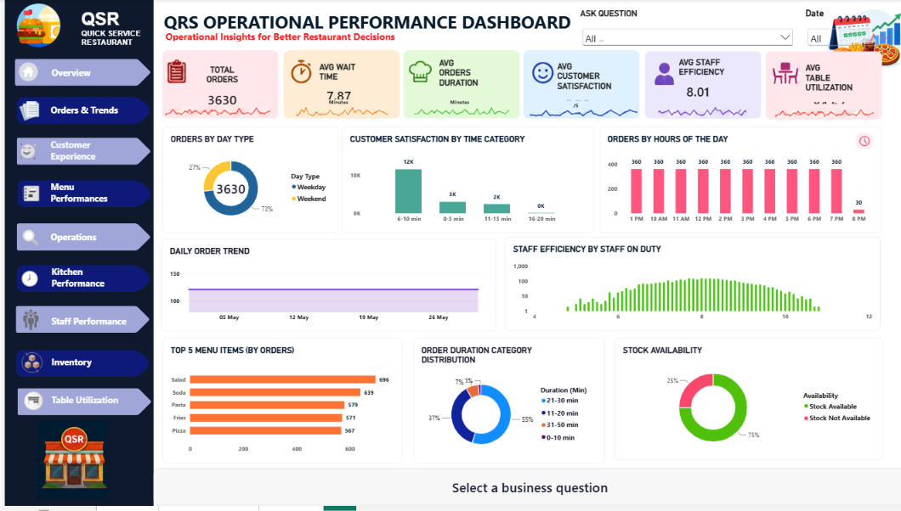

# QSR Operational Analysis

An end-to-end data analysis of Quick Service Restaurant (QSR) operations, covering waiting time, order duration, staff efficiency, customer satisfaction and inventory availability.

**Tools:** Python, MySQL, Power BI, Excel

---

## Business Problem

QSR businesses depend on fast service, available stock and efficient staff. This project looks for operational bottlenecks that hurt customer satisfaction and gives stakeholders data-backed recommendations to fix them.

**Key questions**
- How often do customers face long waiting times?
- How often is stock unavailable when customers order?
- How strongly do waiting time and staff efficiency affect customer satisfaction?
- Where should the business focus first to improve operations?

---

## Dataset

- **Records:** 3,630 QSR order records
- **Key fields:** waiting time, order duration, staff efficiency, customer satisfaction, inventory availability
- **Source:** [add source, for example Kaggle or a self-generated dataset]

---

## Approach

1. **Data cleaning and transformation (Python):** handled missing values, duplicates and data types, and created derived columns.
2. **Data analysis (MySQL):** wrote SQL queries to calculate KPIs for waiting time, stock availability and satisfaction.
3. **Correlation analysis (Python):** measured how waiting time and staff efficiency relate to customer satisfaction.
4. **Dashboard (Power BI):** built an interactive multi-page dashboard with navigation buttons and a question-based exploration feature.
5. **Recommendations:** turned the findings into actions for stakeholders.

---

## Key Findings

| Metric | Result |
|---|---|
| Orders with long waiting times | **15.2%** |
| Orders with stock unavailability | **25%** |
| Waiting time vs customer satisfaction | **-0.306** (moderate negative correlation) |
| Staff efficiency vs customer satisfaction | **0.578** (strong positive correlation) |

- Staff efficiency has a stronger link to customer satisfaction than waiting time.
- Longer waiting times are associated with lower satisfaction.
- One in four orders is affected by stock unavailability, which makes inventory a quick area to improve.

> Correlation shows a relationship, not proof of cause.

---

## Recommendations

- **Optimise staff allocation during peak hours** to improve efficiency and reduce waiting times.
- **Improve inventory replenishment practices** to reduce stock unavailability.
- **Monitor waiting-time KPIs** regularly to catch service issues early.

---

## Power BI Dashboard

**Features**
- Multiple analytical pages
- Navigation buttons
- Question-based exploration feature
- Operational KPI tracking

**Screenshots**



---

## Project Structure

```
├── data/              # raw and cleaned datasets
├── notebooks/         # Python cleaning and analysis
├── sql/               # MySQL queries
├── dashboard/         # Power BI (.pbix) file
├── images/            # dashboard screenshots
└── README.md
```

---

## How to Run

1. Clone the repository
   ```
   git clone [your-repo-link]
   ```
2. Open the Python notebook in `notebooks/` to view the cleaning and analysis.
3. Run the SQL scripts in `sql/` on a MySQL database.
4. Open the `.pbix` file in Power BI Desktop to explore the dashboard.

---

## Skills Demonstrated

Data Cleaning | Data Transformation | SQL Querying | Correlation Analysis | KPI Tracking | Data Visualisation | Dashboard Development | Business Recommendations

---

## Author

**Merlin**
# QSR Operational Analysis

An end-to-end data analysis of Quick Service Restaurant (QSR) operations, covering waiting time, order duration, staff efficiency, customer satisfaction and inventory availability.

**Tools:** Python, MySQL, Power BI, Excel

---

## Business Problem

QSR businesses depend on fast service, available stock and efficient staff. This project looks for operational bottlenecks that hurt customer satisfaction and gives stakeholders data-backed recommendations to fix them.

**Key questions**
- How often do customers face long waiting times?
- How often is stock unavailable when customers order?
- How strongly do waiting time and staff efficiency affect customer satisfaction?
- Where should the business focus first to improve operations?

---

## Dataset

- **Records:** 3,630 QSR order records
- **Key fields:** waiting time, order duration, staff efficiency, customer satisfaction, inventory availability
- **Source:** [add source, for example Kaggle or a self-generated dataset]

---

## Approach

1. **Data cleaning and transformation (Python):** handled missing values, duplicates and data types, and created derived columns.
2. **Data analysis (MySQL):** wrote SQL queries to calculate KPIs for waiting time, stock availability and satisfaction.
3. **Correlation analysis (Python):** measured how waiting time and staff efficiency relate to customer satisfaction.
4. **Dashboard (Power BI):** built an interactive multi-page dashboard with navigation buttons and a question-based exploration feature.
5. **Recommendations:** turned the findings into actions for stakeholders.

---

## Key Findings

| Metric | Result |
|---|---|
| Orders with long waiting times | **15.2%** |
| Orders with stock unavailability | **25%** |
| Waiting time vs customer satisfaction | **-0.306** (moderate negative correlation) |
| Staff efficiency vs customer satisfaction | **0.578** (strong positive correlation) |

- Staff efficiency has a stronger link to customer satisfaction than waiting time.
- Longer waiting times are associated with lower satisfaction.
- One in four orders is affected by stock unavailability, which makes inventory a quick area to improve.

> Correlation shows a relationship, not proof of cause.

---

## Recommendations

- **Optimise staff allocation during peak hours** to improve efficiency and reduce waiting times.
- **Improve inventory replenishment practices** to reduce stock unavailability.
- **Monitor waiting-time KPIs** regularly to catch service issues early.

---

## Power BI Dashboard

**Features**
- Multiple analytical pages
- Navigation buttons
- Question-based exploration feature
- Operational KPI tracking

**Screenshots**


---

## Project Structure

```
├── data/              # raw and cleaned datasets
├── notebooks/         # Python cleaning and analysis
├── sql/               # MySQL queries
├── dashboard/         # Power BI (.pbix) file
├── images/            # dashboard screenshots
└── README.md
```

---

## How to Run

1. Clone the repository
2. Open the Python notebook in `notebooks/` to view the cleaning and analysis.
3. Run the SQL scripts in `sql/` on a MySQL database.
4. Open the `.pbix` file in Power BI Desktop to explore the dashboard.

---

## Skills Demonstrated

Data Cleaning | Data Transformation | SQL Querying | Correlation Analysis | KPI Tracking | Data Visualisation | Dashboard Development | Business Recommendations

---

## Author

**Merlin**
http://www.linkedin.com/in/merlin-keerthana  | merlink470@gmail.com
